# 餐厅点餐系统

> 🎓 **计算机毕业设计 · 餐厅点餐系统**
>
> 本仓库只放**项目介绍 + 运行截图**（截图是站点带水印的原图，存在仓库 `images/` 里）。
>
> 👉 **完整可运行源码 / 数据库脚本 / 部署文档：[点我获取](https://geekcode.top/archives/%E9%A4%90%E5%8E%85%E7%82%B9%E9%A4%90%E7%B3%BB%E7%BB%9F?utm_source=github)**
>
> 💬 咨询微信：**ir9372**　|　🌐 更多项目：[极客代码 geekcode.top](https://geekcode.top/?utm_source=github)
>
> 📌 项目详情页：<https://geekcode.top/archives/%E9%A4%90%E5%8E%85%E7%82%B9%E9%A4%90%E7%B3%BB%E7%BB%9F?utm_source=github>

<table><td width="230" align="center"> <b>扫码加微信 ir9372</b></td><td valign="middle">📦 源码 = 项目介绍 + 全部运行截图 + 数据库 + 部署文档 👉 点上方任意截图，直接跳到 <b>极客代码 geekcode.top</b> 详情页</td></table>

---

<h1>餐厅点餐系统</h1>
<h2>项目概述</h2>

本项目为基于 Spring Boot 与 Vue 技术栈构建的餐厅点餐系统，旨在实现餐饮业务的数字化管理。系统采用前后端分离架构，涵盖前台用户服务与后台运营管理两大核心模块。前台提供菜品浏览、分类检索、在线下单、餐桌预约及评价互动功能；后台支持菜品信息维护、订单处理、用户管理及内容发布。适用人群包括餐厅顾客、管理员及运营人员。通过 MyBatis-Plus 实现高效数据持久化，结合 Shiro 框架保障系统安全，有效解决了传统人工点餐效率低、数据统计难的问题，提升了餐厅的服务质量与管理水平。

<h2>技术架构</h2>

本系统采用典型的前后端分离架构设计，确保系统的可维护性与扩展性。

<strong>1. 后端架构</strong>

<ul>
<li><strong>核心框架</strong>：基于 <code>spring-boot-starter-web</code> 构建 RESTful API 接口层，利用其自动配置特性简化开发流程。</li>
<li><strong>持久层</strong>：集成 <code>mybatis-plus</code> 及其 starter，提供通用的 CRUD 操作封装，减少 SQL 编写工作量；使用 <code>mysql-connector-java</code> 连接 MySQL 数据库。</li>
<li><strong>安全控制</strong>：引入 <code>shiro-spring</code> 进行身份认证与权限授权，保护敏感接口免受未授权访问。</li>
<li><strong>辅助组件</strong>：使用 <code>commons-lang3</code> 处理字符串与对象工具类，<code>validation-api</code> 实现参数校验，<code>protobuf-java</code> 用于特定场景下的数据传输优化（视具体业务而定）。</li>
</ul>

<strong>2. 前端架构</strong>

<ul>
<li><strong>视图层</strong>：采用 Vue.js 框架构建单页应用（SPA），分为前台用户界面与后台管理界面两套路由体系。</li>
<li><strong>交互逻辑</strong>：通过 Axios 等 HTTP 客户端与后端 Controller 层进行数据交互，实现动态渲染与状态管理。</li>
</ul>

<strong>3. 数据库设计要点</strong>

<ul>
<li>依据 Controller 列表推断，数据库主要包含以下核心实体表：</li>
<li><strong>基础数据表</strong>：<code>caipinxinxi</code> (菜品信息), <code>caipinfenlei</code> (菜品分类), <code>canzhuo</code> (餐桌), <code>config</code> (系统配置)。</li>
<li><strong>业务交易表</strong>：<code>caipindingdan</code> (菜品订单), <code>storeup</code> (收藏记录)。</li>
<li><strong>互动内容表</strong>：<code>news</code> (资讯), <code>caipinpingjia</code> (评价), <code>discusscaipinxinxi</code> (评论)。</li>
<li><strong>用户管理表</strong>：<code>yonghu</code> (用户), <code>admin</code> (隐含的管理员角色，通常由 Shiro 或独立表支撑)。</li>
<li>各表之间通过外键关联，如订单关联用户与菜品，评价关联菜品与用户，形成完整的数据闭环。</li>
</ul>
<h2>功能模块</h2>
<h3>前台用户端</h3>

前台面向普通消费者，侧重于信息获取与服务体验。

<ol>
<li><strong>首页展示</strong>：轮播图展示热门菜品或促销活动，快速入口导航。</li>
<li><strong>菜品浏览</strong>：</li>
</ol>
<ul>
<li><strong>菜品信息列表</strong>：展示所有上架菜品，支持按名称搜索。</li>
<li><strong>菜品分类列表</strong>：根据 <code>caipinfenlei</code> 表数据对菜品进行归类展示。</li>
<li><strong>菜品详情</strong>：查看菜品图片、描述、价格及库存等信息。</li>
</ul>
<ol start="3">
<li><strong>资讯阅读</strong>：</li>
</ol>
<ul>
<li><strong>菜品资讯列表/详情</strong>：展示餐厅新闻、美食推荐等内容（对应 <code>/news</code> 路由）。</li>
</ul>
<ol start="4">
<li><strong>互动社区</strong>：</li>
</ol>
<ul>
<li><strong>菜品评价列表/详情</strong>：查看其他用户对菜品的评分与文字评价（对应 <code>/caipinpingjia</code>）。</li>
<li><strong>菜品评论列表/详情</strong>：针对资讯或菜品的详细讨论区（对应 <code>/discusscaipinxinxi</code>）。</li>
</ul>
<ol start="5">
<li><strong>个人中心</strong>：</li>
</ol>
<ul>
<li><strong>登录/注册</strong>：新用户注册与老用户登录验证。</li>
<li><strong>我的收藏</strong>：查看已收藏的菜品列表（对应 <code>/storeup</code>）。</li>
<li><strong>菜品订单</strong>：查看历史订单状态、详情及管理待支付/已完成订单（对应 <code>/caipindingdan</code>）。</li>
<li><strong>餐桌预约/查看</strong>：查看可用餐桌信息及状态（对应 <code>/canzhuo</code>）。</li>
</ul>
<h3>后台管理端</h3>

后台面向管理员，侧重于数据维护与业务管控。

<ol>
<li><strong>系统管理</strong>：</li>
</ol>
<ul>
<li><strong>登录页</strong>：管理员身份验证入口。</li>
<li><strong>首页仪表盘</strong>：展示关键业务数据概览。</li>
<li><strong>轮播图管理</strong>：配置前台展示的 Banner 图片。</li>
<li><strong>系统配置</strong>：修改网站基本参数（对应 <code>/config</code>）。</li>
</ul>
<ol start="2">
<li><strong>内容管理</strong>：</li>
</ol>
<ul>
<li><strong>菜品信息管理</strong>：增删改查菜品详情、上传图片、设置价格与状态（对应 <code>/caipinxinxi</code>）。</li>
<li><strong>菜品分类管理</strong>：维护菜品类别结构（对应 <code>/caipinfenlei</code>）。</li>
<li><strong>菜品资讯管理</strong>：发布与编辑餐厅新闻文章（对应 <code>/news</code>）。</li>
</ul>
<ol start="3">
<li><strong>用户与互动管理</strong>：</li>
</ol>
<ul>
<li><strong>用户管理</strong>：查看注册用户信息，禁用异常账号（对应 <code>/yonghu</code>）。</li>
<li><strong>我的收藏管理</strong>：查看用户的收藏行为数据（对应 <code>/storeup</code>）。</li>
<li><strong>菜品评价管理</strong>：审核或删除不当评价（对应 <code>/caipinpingjia</code>）。</li>
<li><strong>菜品信息评论管理</strong>：监控与维护评论区秩序（对应 <code>/discusscaipinxinxi</code>）。</li>
</ul>
<ol start="4">
<li><strong>业务管理</strong>：</li>
</ol>
<ul>
<li><strong>餐桌管理</strong>：维护餐桌编号、容量及占用状态（对应 <code>/canzhuo</code>）。</li>
<li><strong>菜品订单管理</strong>：处理用户提交的订单，更新订单状态（如接单、完成、取消）（对应 <code>/caipindingdan</code>）。</li>
</ul>
<h2>用户角色与权限</h2>

根据系统架构与截图功能分析，主要存在两类角色：

<table>
<thead>
<tr>
<th align="left">角色</th>
<th align="left">权限范围</th>
<th align="left">可访问模块</th>
</tr>
</thead>
<tbody><tr>
<td align="left"><strong>普通用户</strong></td>
<td align="left">仅具备前台浏览、下单、互动及个人数据查看权限。无后台管理权限。</td>
<td align="left">**前台：**1. 首页2. 菜品信息（浏览、详情、评论）3. 菜品资讯（浏览、详情）4. 个人中心（登录、注册、修改资料）5. 我的收藏（添加、删除、查看）6. 菜品订单（创建、查看、取消）7. 餐桌（查看状态）8. 菜品评价（提交、查看）</td>
</tr>
<tr>
<td align="left"><strong>管理员</strong></td>
<td align="left">拥有全系统最高权限，可进行数据CRUD、状态流转及配置修改。</td>
<td align="left">**后台：**1. 系统登录2. 首页看板3. 轮播图管理4. 系统配置5. 用户管理6. 菜品分类管理7. 菜品信息管理8. 餐桌管理9. 菜品订单管理10. 菜品资讯管理11. 菜品评价管理12. 菜品信息评论管理13. 我的收藏管理（查看）</td>
</tr>
</tbody></table>

<em>注：Shiro 框架负责鉴权，确保不同角色只能访问其授权的路由资源。</em>

<h2>项目特色与创新点</h2>
<ol>
<li><strong>完整的业务闭环</strong>：系统不仅实现了基础的“浏览-下单”流程，还融入了“餐桌管理”、“评价体系”和“资讯传播”，构建了从营销到服务再到反馈的完整餐饮生态。</li>
<li><strong>灵活的内容管理</strong>：通过独立的“菜品资讯”和“轮播图管理”模块，允许运营人员低成本地进行品牌宣传和内容更新，无需频繁改动代码即可调整前台展示效果。</li>
<li><strong>高内聚低耦合架构</strong>：后端采用 Spring Boot + MyBatis-Plus 组合，大幅减少了样板代码，提升了开发效率；前端 Vue 的双向绑定机制使得菜品筛选、订单状态同步等交互更加流畅。</li>
<li><strong>安全性保障</strong>：集成 Apache Shiro 框架，对用户密码加密存储、Session 管理及接口权限拦截提供了成熟的安全解决方案，防止越权访问和数据泄露。</li>
</ol>
<h2>部署环境</h2>

为确保系统正常运行，需准备以下软件环境：

<ol>
<li><strong>操作系统</strong>：Windows 10/11, Linux (CentOS/Ubuntu) 或 macOS。</li>
<li><strong>Java 运行环境</strong>：JDK 1.8 或更高版本（建议 JDK 8 LTS，以兼容 Spring Boot 早期版本及依赖库）。</li>
<li><strong>数据库</strong>：MySQL 5.7 或 MySQL 8.0，需安装并配置好 root 权限账户及字符集（utf8mb4）。</li>
<li><strong>Web 服务器</strong>：内置 Tomcat（Spring Boot 自带），生产环境可选配 Nginx 作为反向代理。</li>
<li><strong>前端构建环境</strong>：Node.js (LTS 版本，建议 v14+) 及 npm/yarn/pnpm 包管理器，用于编译 Vue 项目源码。</li>
<li><strong>开发工具</strong>（可选）：IntelliJ IDEA, VS Code, Navicat for MySQL。</li>
</ol>
<h2>五、技术特性</h2>
<ul>
<li>前后端集成部署，前端资源打包至后端 static 目录</li>
<li>使用 MyBatis-Plus 简化数据访问层开发</li>
<li>集成 Shiro 权限框架实现角色权限控制</li>
</ul>
<h2>六、功能模块截图</h2>
<h3>前台用户端</h3>
<h4>前台首页</h4>

<a href="https://geekcode.top/archives/%E9%A4%90%E5%8E%85%E7%82%B9%E9%A4%90%E7%B3%BB%E7%BB%9F?utm_source=github" title="查看完整源码">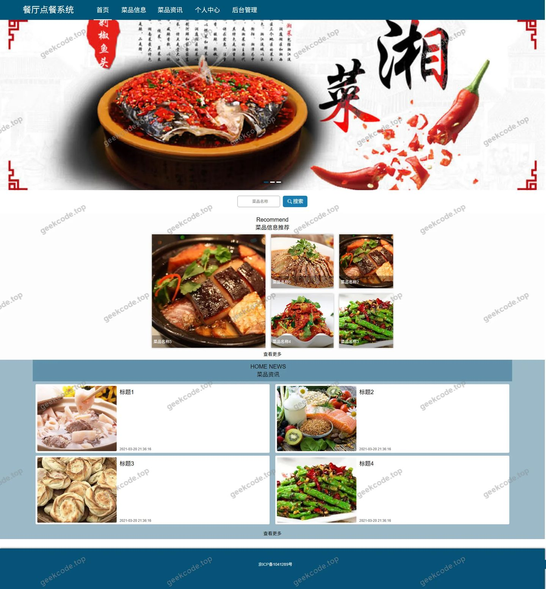</a>

<h4>前台登录页</h4>

<a href="https://geekcode.top/archives/%E9%A4%90%E5%8E%85%E7%82%B9%E9%A4%90%E7%B3%BB%E7%BB%9F?utm_source=github" title="查看完整源码">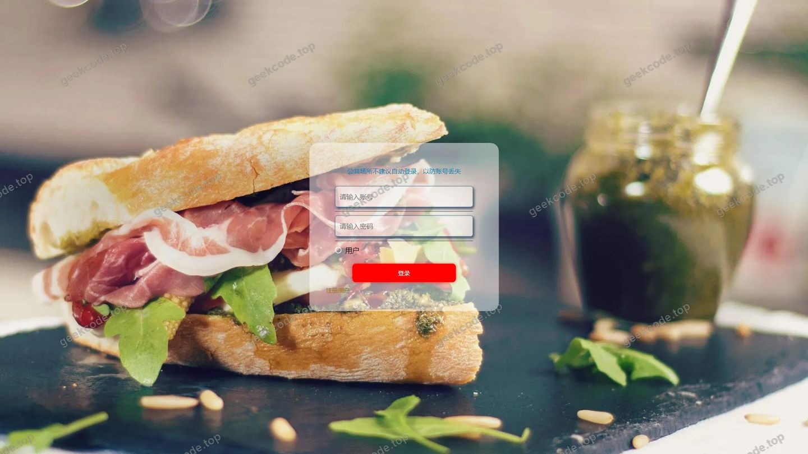</a>

<h4>前台注册页</h4>

<a href="https://geekcode.top/archives/%E9%A4%90%E5%8E%85%E7%82%B9%E9%A4%90%E7%B3%BB%E7%BB%9F?utm_source=github" title="查看完整源码">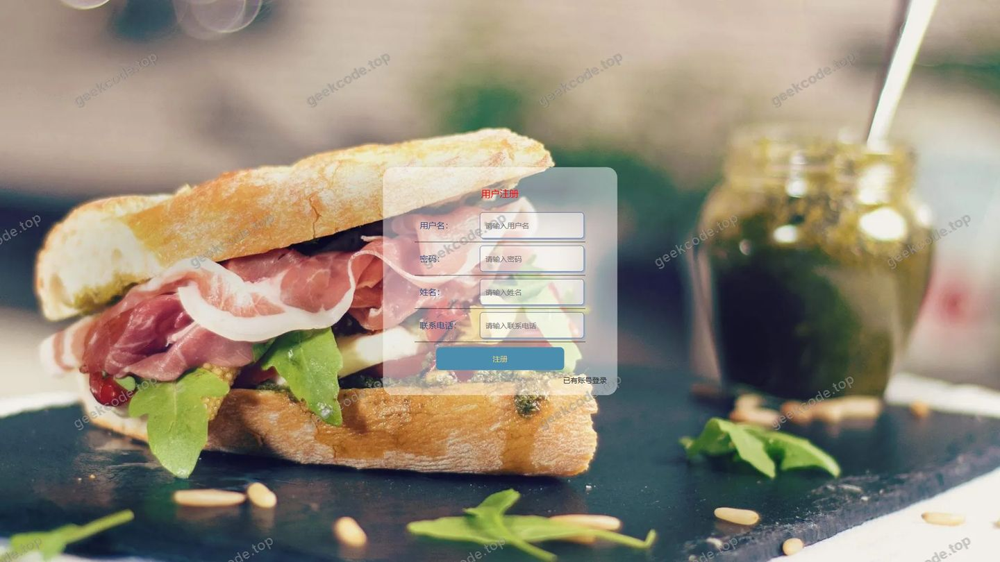</a>

<h4>前台-菜品信息列表</h4>

<a href="https://geekcode.top/archives/%E9%A4%90%E5%8E%85%E7%82%B9%E9%A4%90%E7%B3%BB%E7%BB%9F?utm_source=github" title="查看完整源码">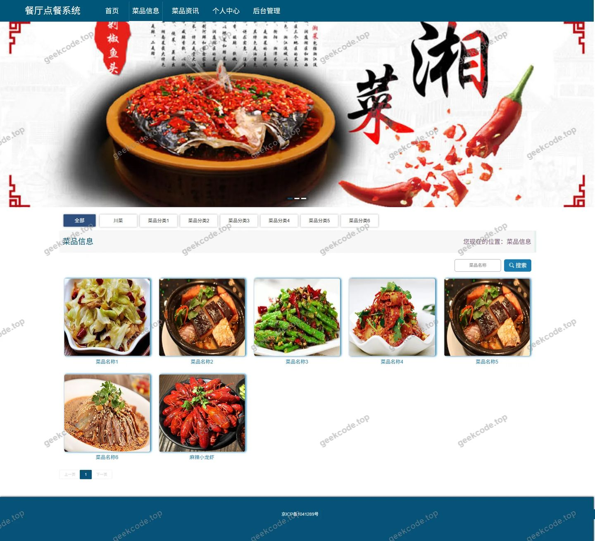</a>

<h4>前台-菜品资讯列表</h4>

<a href="https://geekcode.top/archives/%E9%A4%90%E5%8E%85%E7%82%B9%E9%A4%90%E7%B3%BB%E7%BB%9F?utm_source=github" title="查看完整源码">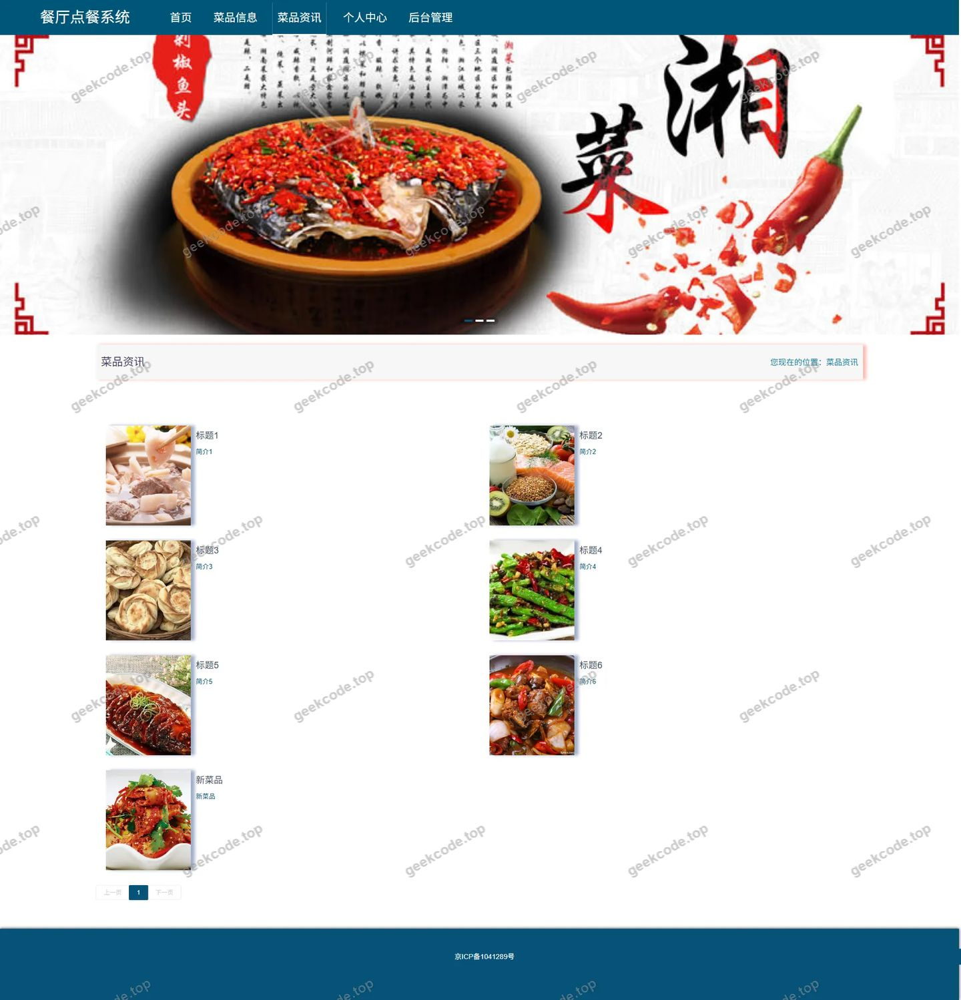</a>

<h4>前台-菜品信息评论列表</h4>

<h4>前台个人中心</h4>

<a href="https://geekcode.top/archives/%E9%A4%90%E5%8E%85%E7%82%B9%E9%A4%90%E7%B3%BB%E7%BB%9F?utm_source=github" title="查看完整源码">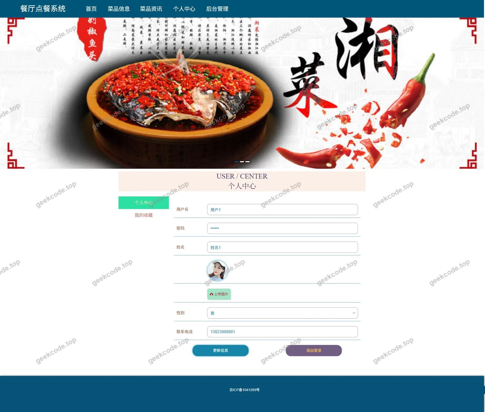</a>

<h4>前台-我的收藏列表</h4>

<a href="https://geekcode.top/archives/%E9%A4%90%E5%8E%85%E7%82%B9%E9%A4%90%E7%B3%BB%E7%BB%9F?utm_source=github" title="查看完整源码">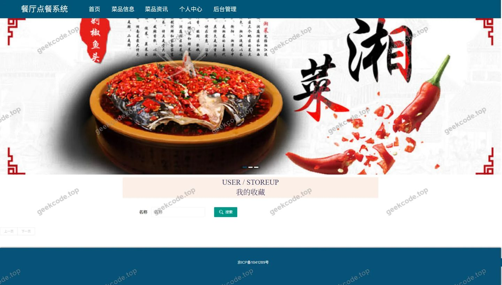</a>

<h4>前台-菜品信息-详情</h4>

<a href="https://geekcode.top/archives/%E9%A4%90%E5%8E%85%E7%82%B9%E9%A4%90%E7%B3%BB%E7%BB%9F?utm_source=github" title="查看完整源码">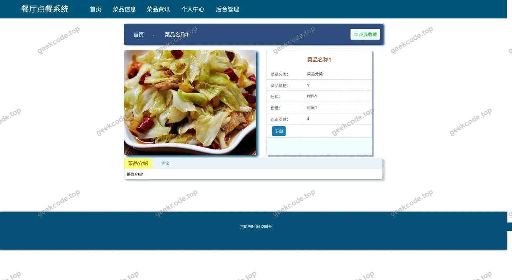</a>

<h4>前台-菜品资讯-详情</h4>

<a href="https://geekcode.top/archives/%E9%A4%90%E5%8E%85%E7%82%B9%E9%A4%90%E7%B3%BB%E7%BB%9F?utm_source=github" title="查看完整源码">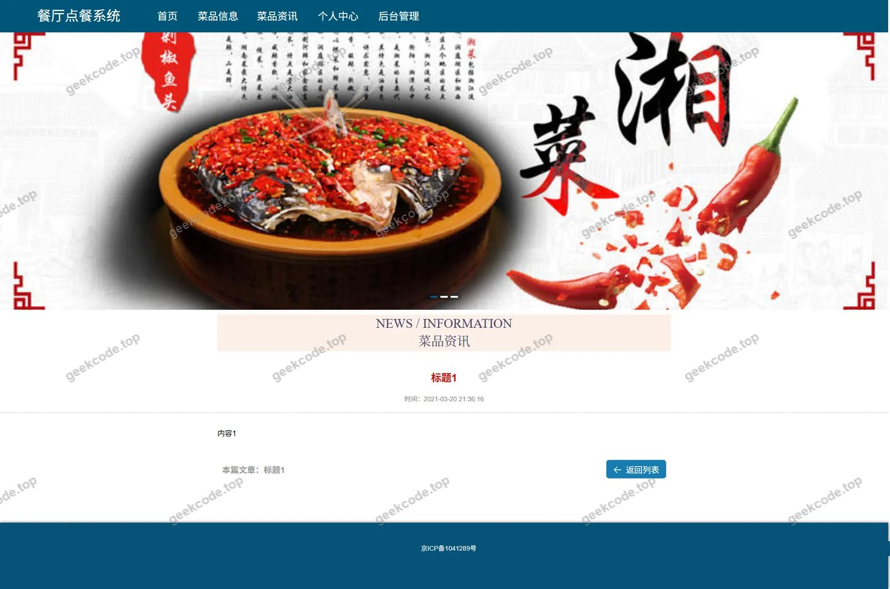</a>

<h4>前台-菜品订单列表</h4>

<h4>前台-菜品分类列表</h4>

<h4>前台-菜品评价列表</h4>

<h4>前台-餐桌列表</h4>

<h4>前台-菜品订单-详情</h4>

<a href="https://geekcode.top/archives/%E9%A4%90%E5%8E%85%E7%82%B9%E9%A4%90%E7%B3%BB%E7%BB%9F?utm_source=github" title="查看完整源码">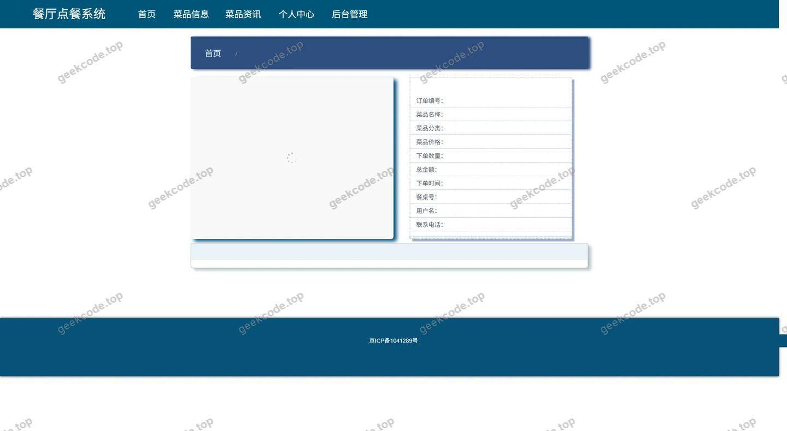</a>

<h4>前台-菜品评价-详情</h4>

<a href="https://geekcode.top/archives/%E9%A4%90%E5%8E%85%E7%82%B9%E9%A4%90%E7%B3%BB%E7%BB%9F?utm_source=github" title="查看完整源码">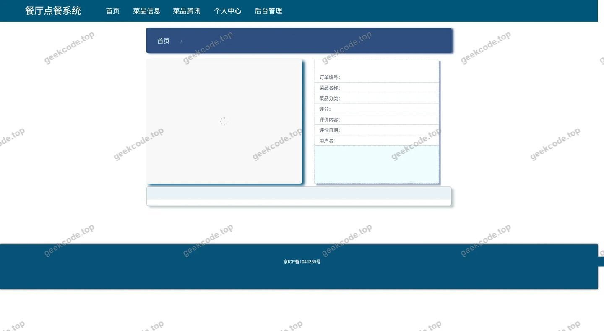</a>

<h4>前台-菜品信息评论-详情</h4>

<a href="https://geekcode.top/archives/%E9%A4%90%E5%8E%85%E7%82%B9%E9%A4%90%E7%B3%BB%E7%BB%9F?utm_source=github" title="查看完整源码">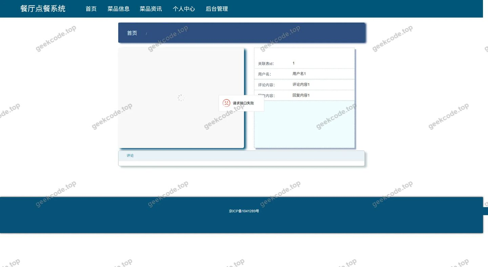</a>

<h3>后台管理端</h3>
<h4>后台-菜品订单</h4>

<a href="https://geekcode.top/archives/%E9%A4%90%E5%8E%85%E7%82%B9%E9%A4%90%E7%B3%BB%E7%BB%9F?utm_source=github" title="查看完整源码">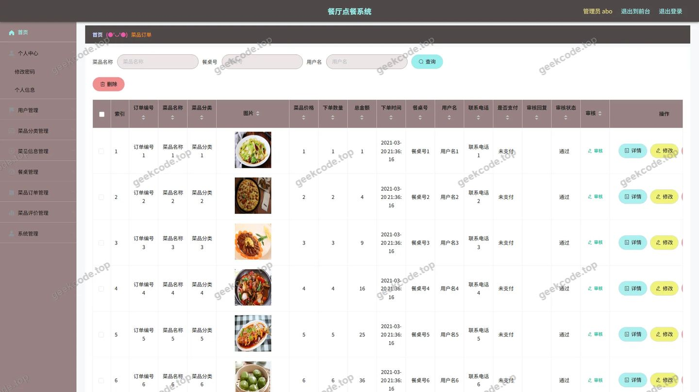</a>

<h4>后台-菜品分类</h4>

<a href="https://geekcode.top/archives/%E9%A4%90%E5%8E%85%E7%82%B9%E9%A4%90%E7%B3%BB%E7%BB%9F?utm_source=github" title="查看完整源码">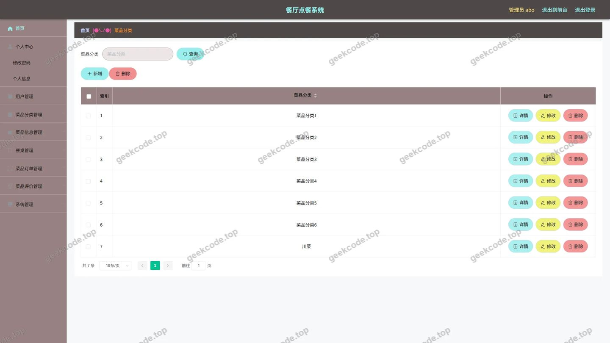</a>

<h4>后台-菜品评价</h4>

<a href="https://geekcode.top/archives/%E9%A4%90%E5%8E%85%E7%82%B9%E9%A4%90%E7%B3%BB%E7%BB%9F?utm_source=github" title="查看完整源码">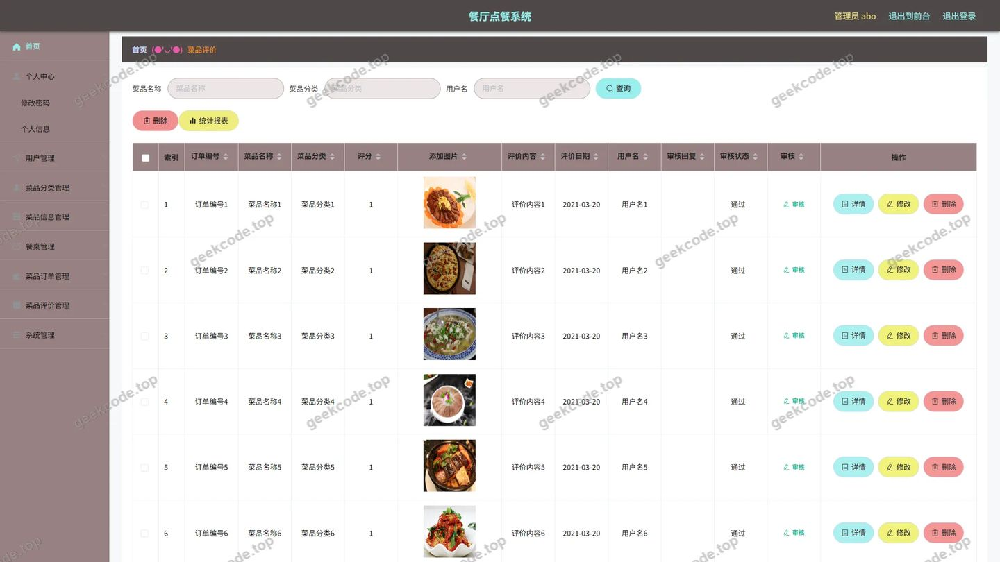</a>

<h4>后台-菜品信息</h4>

<a href="https://geekcode.top/archives/%E9%A4%90%E5%8E%85%E7%82%B9%E9%A4%90%E7%B3%BB%E7%BB%9F?utm_source=github" title="查看完整源码">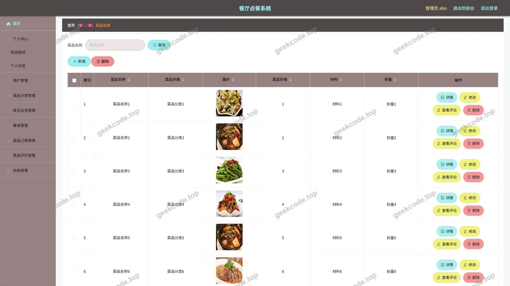</a>

<h4>后台-餐桌</h4>

<a href="https://geekcode.top/archives/%E9%A4%90%E5%8E%85%E7%82%B9%E9%A4%90%E7%B3%BB%E7%BB%9F?utm_source=github" title="查看完整源码">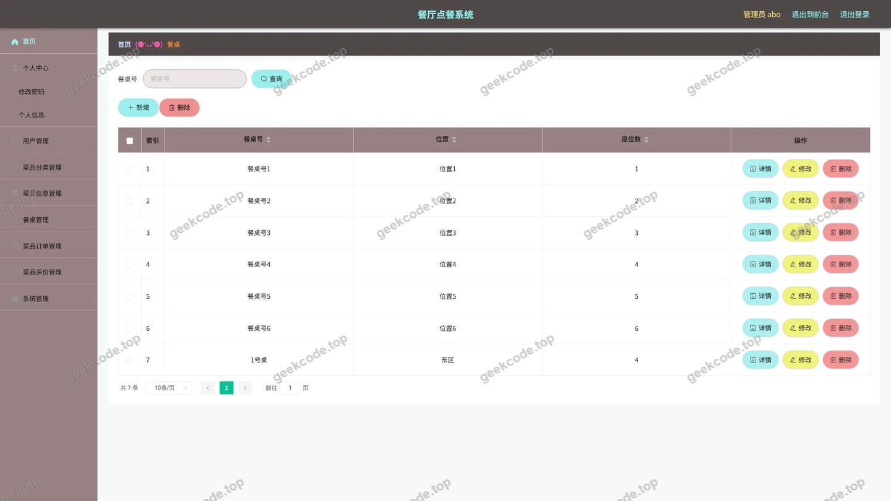</a>

<h4>后台-系统配置</h4>

<a href="https://geekcode.top/archives/%E9%A4%90%E5%8E%85%E7%82%B9%E9%A4%90%E7%B3%BB%E7%BB%9F?utm_source=github" title="查看完整源码">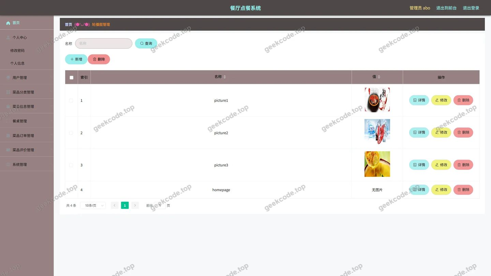</a>

<h4>后台-菜品信息评论</h4>

<a href="https://geekcode.top/archives/%E9%A4%90%E5%8E%85%E7%82%B9%E9%A4%90%E7%B3%BB%E7%BB%9F?utm_source=github" title="查看完整源码">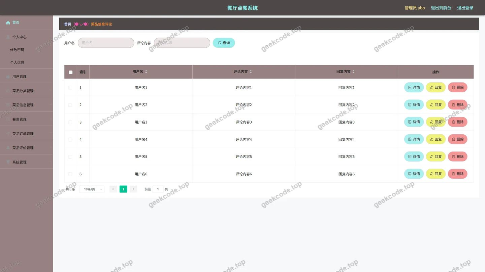</a>

<h4>后台首页</h4>

<a href="https://geekcode.top/archives/%E9%A4%90%E5%8E%85%E7%82%B9%E9%A4%90%E7%B3%BB%E7%BB%9F?utm_source=github" title="查看完整源码">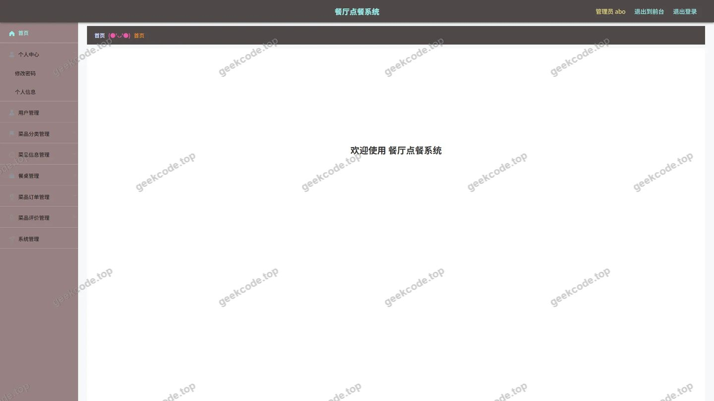</a>

<h4>后台-登录</h4>

<h4>后台-公告信息</h4>

<a href="https://geekcode.top/archives/%E9%A4%90%E5%8E%85%E7%82%B9%E9%A4%90%E7%B3%BB%E7%BB%9F?utm_source=github" title="查看完整源码">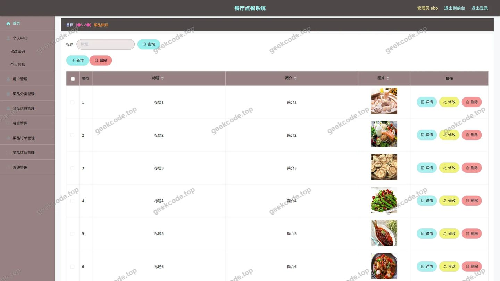</a>

<h4>后台-收藏</h4>

<a href="https://geekcode.top/archives/%E9%A4%90%E5%8E%85%E7%82%B9%E9%A4%90%E7%B3%BB%E7%BB%9F?utm_source=github" title="查看完整源码">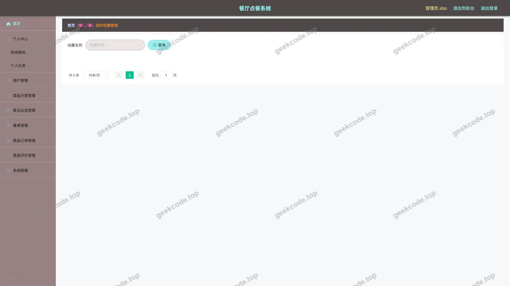</a>

---

## 获取完整源码

| 项目 | 说明 |
| --- | --- |
| 项目名 | 餐厅点餐系统 |
| 运行截图 | 本文 28 张（站点带水印原图，仓库 `images/` 目录） |
| 完整源码 | [https://geekcode.top/archives/%E9%A4%90%E5%8E%85%E7%82%B9%E9%A4%90%E7%B3%BB%E7%BB%9F?utm_source=github](https://geekcode.top/archives/%E9%A4%90%E5%8E%85%E7%82%B9%E9%A4%90%E7%B3%BB%E7%BB%9F?utm_source=github) |
| 咨询微信 | **ir9372**（备注：jingpin-yuanma） |
| 更多项目 | [极客代码 geekcode.top](https://geekcode.top/?utm_source=github) |

> 需要源码、部署、改配置、跑不起来等问题，加微信 ir9372 沟通，说明项目名即可。
